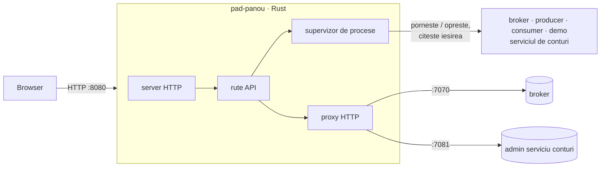

# Interfața web în Rust — panou de control pentru laboratoarele 1 și 2

**Student:** Dumitru Micleușanu

Un program **Rust** pornește un server web local și afișează un link (`http://localhost:8080/`). Deschis în browser, linkul arată un panou din care rulezi și urmărești laboratoarele 1 și 2: pornești brokerul, serviciul de conturi, producerii și consumerii, provoci căderi și defecte, și vezi în timp real cozile, soldurile, registrele și jurnalele.

Programul folosește **doar biblioteca standard Rust**, fără biblioteci externe. Serverul HTTP, proxy-ul și supervizorul de procese sunt scrise de la zero.

## Pornire

Cerințe: **Rust** (https://rustup.rs) și **Go 1.22+** (https://go.dev/dl/), ambele în PATH.

```powershell
cd interfata_rust
cargo run --release
```

În terminal apare:

```
  ╔══════════════════════════════════════════════════════════╗
  ║  Panoul de control PAD (Rust) ruleaza                    ║
  ║  Deschide in browser:   http://localhost:8080/           ║
  ╚══════════════════════════════════════════════════════════╝
```

Browserul se deschide singur. Dacă nu se deschide, copiază linkul. La prima utilizare apasă **⚒ Compilează** în panou: se compilează programele Go ale laboratorului (durează până la un minut).

Opțiuni: `cargo run --release -- --port 9000` (alt port), `--no-browser` (nu deschide browserul), `--root <cale>` (dacă rulezi programul din alt folder).

Oprire: **Ctrl+C** în terminal. Se opresc și procesele pornite din panou.

## Ce găsești în panou

| Zonă | Conținut |
|---|---|
| Antet | comutare **Laboratorul 1 / Laboratorul 2**, starea brokerului și a serviciului |
| Stânga | procesele pornite (cu buton **💥 kill** pentru consumeri, adică o cădere bruscă), formulare pentru producer și consumer |
| Mijloc | **scenariile** laboratorului, fiecare cu explicație, butonul **▶ Rulează automat** și pașii separați; demo-ul automat |
| Dreapta | broker (contoare, relivrări, lease expirat), serviciul de conturi (solduri, operații, versiuni v1/v2), registrele consumerilor (efecte duplicate), DLQ cu *replay* |
| Jos | jurnalele fiecărui proces (colorate) și evenimentele brokerului |

**Laboratorul 1:** scenariul critic (naiv vs. idempotent), ACK pierdut către producer, retry + DLQ, ordonare cu 3 consumeri, consumer manual (ACK / NACK / cădere).
**Laboratorul 2:** scenariul critic (răspuns pierdut), defecte în serviciu, fallback (serviciul cade și revine), versionare v1/v2 și server vechi.

## Cum funcționează



| Fișier | Rol |
|---|---|
| `src/main.rs` | argumente, găsirea folderelor `laborator_1/2`, pornirea serverului, deschiderea browserului |
| `src/http.rs` | server HTTP/1.1 minimal: parsarea cererii, query string, răspunsuri |
| `src/app.rs` | rutele API (`/api/start`, `/api/stop`, `/api/state`, `/api/ledger` …) și fișierele interfeței |
| `src/procs.rs` | supervizorul: pornește executabilele Go, le citește ieșirea linie cu linie, detectează codul de ieșire (3 = cădere simulată), le oprește |
| `src/commands.rs` | lista **fixă** de comenzi permise și validarea parametrilor: panoul nu execută comenzi arbitrare din browser |
| `src/proxy.rs` | client HTTP către broker și serviciu (inclusiv `Transfer-Encoding: chunked`) |
| `src/json.rs` | construirea răspunsurilor JSON |
| `ui/` | pagina web (HTML, CSS, JavaScript), inclusă în executabil la compilare |

Teste: `cargo test` (parsare HTTP, chunked, validarea comenzilor, supervizorul de procese).

## Probleme frecvente

* **`go` nu este găsit:** închide și redeschide terminalul după instalarea Go. Panoul afișează un avertisment roșu dacă nu îl găsește.
* **„An Application Control policy has blocked this file”:** Windows (Smart App Control) blochează programele nesemnate. Vezi instrucțiunile din laborator.
* **Rust pe Windows cere „Visual Studio Build Tools”:** la instalare, `rustup` propune instalarea lor (componenta *Desktop development with C++*). Alternativ, fără Visual Studio: `rustup default stable-x86_64-pc-windows-gnu`.
* **Port ocupat:** panoul încearcă singur următoarele porturi (8081, 8082 …). Brokerul (7070) și serviciul (7080/7081) trebuie să fie libere: apasă **Oprește tot** sau închide procesele rămase pornite.
