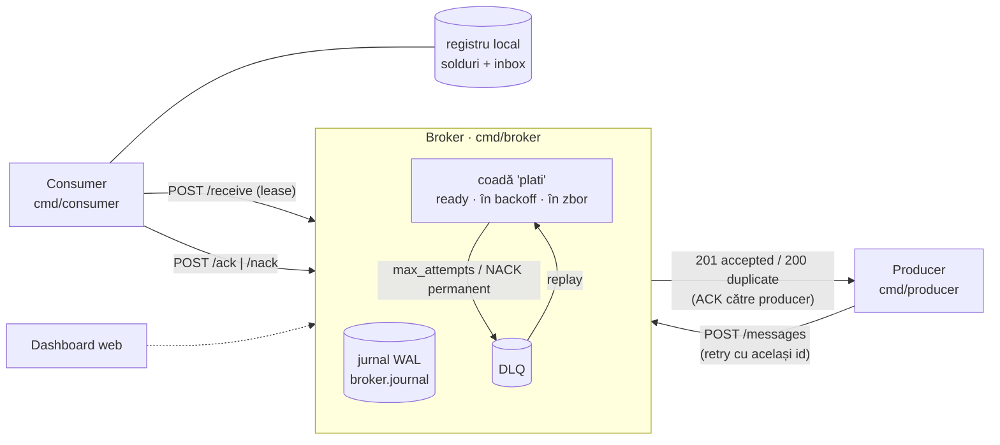
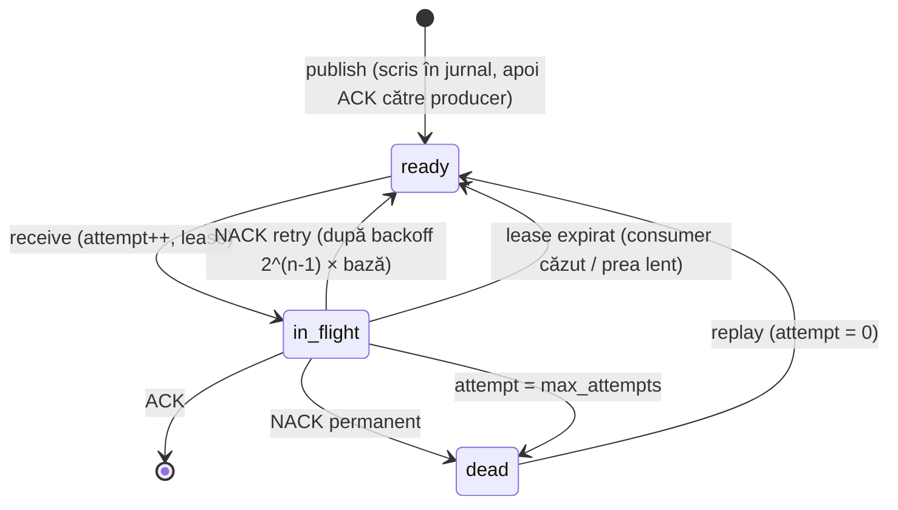
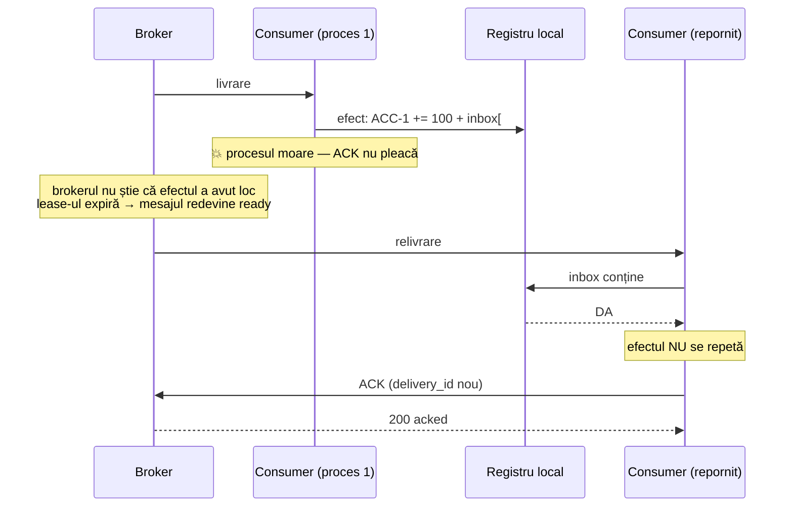

# Laborator 1 — Comunicare fiabilă și mesagerie

**Student:** Dumitru Micleușanu
**Disciplina:** Programarea Aplicațiilor Distribuite (PAD), 2026

Fluxul **producer → broker → consumer** implementat de la zero în **Go** (doar biblioteca standard, zero dependențe externe), cu accent pe relația dintre *livrarea* unui mesaj și *confirmarea efectului* său.

| Concept | Unde este implementat |
|---|---|
| Contract de mesaj | `contract/message.go` — plic versionat, validare strictă la intrarea în broker |
| ACK / NACK | `broker/broker.go` — `Ack`, `Nack(retry=true/false)`, confirmare pe `delivery_id` |
| Retry | producer: `client.PublishWithRetry` (backoff + jitter); broker: backoff exponențial după NACK și relivrare după expirarea lease-ului |
| Deduplicare | broker: după `id` la publicare; consumer: *inbox* scris atomic împreună cu efectul |
| Ordering | broker: FIFO strict **per cheie** (un singur mesaj în zbor pe cheie) + `seq` monoton per `(source, key)` |
| Dead-letter queue | broker: după `max_attempts` sau la NACK permanent; inspectare + *replay* |
| Persistență | `broker/journal.go` — jurnal write-ahead (JSON Lines, fsync), recuperare și compactare |

---

## 1. Arhitectură



Efectul folosit în laborator este **alimentarea unui cont** (`payment.credit`). A fost ales intenționat pentru că **nu este idempotent natural**: aplicat de două ori, dublează suma — un duplicat devine imediat vizibil în sold.

### Structura proiectului

```
laborator_1/
├── contract/        contractul de mesaj (Message, Delivery, CreditPayload) + teste
├── broker/          nucleul brokerului, jurnalul persistent, API-ul HTTP + teste
├── client/          clientul HTTP (publicare cu retry, receive, ack, nack) + teste
├── consumer/        registrul local cu inbox și bucla de procesare + teste (scenariul critic)
├── cmd/
│   ├── broker/      executabilul brokerului + dashboard web inclus în binar
│   ├── producer/    generator de mesaje cu retry
│   ├── consumer/    consumer cu moduri: idempotent / naiv / cădere simulată / erori
│   └── demo/        toate scenariile cap-coadă într-o singură comandă
└── scripts/         scenariul critic cu procese reale (bash și PowerShell)
```

---

## 2. Contractul de mesaj

```json
{
  "id": "6a4f762d-1c0e-4b8a-9d55-2f1e0c3b7a90",
  "type": "payment.credit",
  "version": 1,
  "source": "producer-acce959e",
  "key": "ACC-1",
  "seq": 3,
  "created_at": "2026-11-12T10:35:56.120Z",
  "payload": { "account": "ACC-1", "amount": 100, "note": "mesaj 3" }
}
```

| Câmp | Rol | Regula de validare |
|---|---|---|
| `id` | identitate + **cheie de idempotență** | obligatoriu, ≤ 128 caractere; generat de producer o singură dată și păstrat la fiecare retry |
| `type` | tipul evenimentului | obligatoriu |
| `version` | versiunea schemei plicului | trebuie să fie `1` |
| `source` | identitatea producer-ului | obligatoriu |
| `key` | **cheia de ordonare** | obligatoriu; mesajele cu aceeași cheie sunt livrate strict în ordine |
| `seq` | număr de secvență per `(source, key)` | ≥ 1, strict crescător; un `seq` vechi cu `id` nou este respins (409) |
| `created_at` | momentul creării | obligatoriu |
| `payload` | conținutul de business | obiect JSON, ≤ 64 KiB |

Validarea **de contract** se face în broker (mesajul invalid nu intră niciodată în coadă → `400 invalid_message`). Validarea **de business** (ex. sumă pozitivă, contul coincide cu cheia) se face în consumer; un mesaj corect sintactic dar imposibil de procesat este *otrăvit* și ajunge în DLQ.

Fiecare livrare primește un **`delivery_id`** (receipt) unic per tentativă. ACK/NACK se fac pe `delivery_id`, nu pe `id`-ul mesajului — astfel, un ACK întârziat al unei tentative expirate nu poate confirma din greșeală o relivrare ulterioară.

---

## 3. API-ul brokerului (HTTP/JSON)

| Metodă și cale | Corp | Răspuns |
|---|---|---|
| `POST /v1/queues/{q}/messages` | `Message` | `201 {status:"accepted", offset}` · `200 {status:"duplicate"}` · `400 invalid_message` · `409 stale_sequence` · `503` |
| `POST /v1/queues/{q}/receive` | `{consumer, max, lease_ms, wait_ms}` | `{deliveries:[{message, delivery_id, attempt, lease_until}]}` (long-poll până la `wait_ms`) |
| `POST /v1/queues/{q}/ack` | `{delivery_id}` | `200 acked` · `409 stale_delivery` |
| `POST /v1/queues/{q}/nack` | `{delivery_id, reason, retry}` | `{outcome:"retry_scheduled"\|"dead_lettered", retry_at, attempt}` |
| `GET /v1/queues` | — | statistici per coadă + configurație |
| `GET /v1/queues/{q}/dlq` | — | conținutul DLQ cu motive |
| `POST /v1/queues/{q}/dlq/{id}/replay` | — | mută mesajul înapoi în coadă |
| `GET /v1/events?since=N` | — | jurnal de evenimente (observabilitate) |
| `GET/PUT /v1/admin/faults` | `{drop_publish_ack: 0..1}` | injectare de defecte |
| `GET /` | — | dashboard web |

---

## 4. Ciclul de viață al unui mesaj



* **Lease (timp de vizibilitate):** cât timp un mesaj este „în zbor”, nu este livrat altui consumer. Dacă lease-ul expiră fără ACK, livrarea este considerată eșuată și mesajul redevine disponibil.
* **Backoff:** după NACK cu retry, mesajul este amânat `bază × 2^(attempt-1)`, plafonat la `backoff_max`. Producer-ul folosește *full jitter* pentru a nu sincroniza reîncercările.
* **DLQ:** un mesaj ajunge aici după `max_attempts` tentative eșuate sau imediat la NACK permanent. Nu blochează restul cozii și poate fi reprocesat manual (*replay*) după corectarea cauzei.

---

## 5. Scenariul critic: consumer-ul cade după efect, înainte de ACK



### Analiza

Brokerul și consumer-ul sunt două sisteme separate; nu există un singur moment în care „efect realizat” și „mesaj confirmat” să devină adevărate simultan. Între cele două există mereu o fereastră, iar o cădere în acea fereastră are doar două rezultate posibile:

| Ordinea | Cădere în fereastră | Consecință |
|---|---|---|
| ACK **înainte** de efect | mesajul e confirmat, efectul lipsește | **pierdere** (at-most-once) |
| ACK **după** efect (aleasă aici) | efectul există, mesajul nu e confirmat | **relivrare** (at-least-once) |

Am ales a doua variantă, pentru că o relivrare se poate corecta, o pierdere nu. Corectitudinea efectului se obține în consumer prin **deduplicare**: identificatorul mesajului se scrie în *inbox* **în aceeași tranzacție locală** cu efectul (fișier temporar + `fsync` + `rename`, deci atomic). La relivrare, mesajul este recunoscut, efectul este omis și se trimite doar ACK-ul. Verificarea inbox-ului și aplicarea efectului se fac sub același lock, deci nici doi workeri care primesc același mesaj (lease expirat în timpul procesării) nu pot aplica efectul de două ori.

**Rezultatul măsurat** (`go run ./cmd/demo -s critic`, 5 × 100 pe ACC-1, cădere după efectul #3):

```
  consumer      sold   asteptat efecte dupl.    relivrari  lease exp.
  NAIV           600        500            1            1           1   ✗ GRESIT
  IDEMPOTENT     500        500            0            1           1   ✓ corect
```

Relivrarea apare în **ambele** cazuri — este comportamentul corect al brokerului. Diferența o face exclusiv consumer-ul.

---

## 6. Garanții

| # | Garanție | Mecanism | Verificat de |
|---|---|---|---|
| G1 | Un mesaj confirmat producer-ului (201/200) nu se pierde, nici la căderea brokerului | jurnal write-ahead, scris (și `fsync`) **înainte** de răspuns | `TestRecoveryAfterCrash` |
| G2 | Un mesaj este livrat **cel puțin o dată** până la ACK sau DLQ | lease + relivrare, starea în zbor redevine `ready` după restart | `TestLeaseExpiryRedelivers` |
| G3 | Retrimiterea de către producer nu creează duplicate în coadă | deduplicare după `id` (fereastră 24h, persistată) | `TestPublishIsIdempotentByID`, `TestPublishRetryAfterLostAck` |
| G4 | Efectul fiecărui mesaj se aplică **exact o dată** (cu consumer idempotent) | inbox scris atomic cu efectul | `TestCriticalScenarioIdempotentConsumerIsExactlyOnceEffect` |
| G5 | Mesajele cu aceeași cheie sunt procesate în ordinea acceptării, inclusiv peste retry-uri | doar capul fiecărei chei este livrabil; `seq` monoton per `(source,key)` | `TestOrderingPerKeyBlocksUntilAck`, `TestOrderingPreservedAcrossRetry` |
| G6 | Un ACK întârziat (lease expirat) nu confirmă o altă tentativă | ACK pe `delivery_id` unic per tentativă → `409` | `TestLeaseExpiryRedelivers` |
| G7 | Un mesaj otrăvit nu blochează coada la nesfârșit | NACK permanent sau `max_attempts` → DLQ, cheia se deblochează | `TestPermanentNackGoesStraightToDLQ`, `TestDeadLetterUnblocksKey` |
| G8 | Mesajele invalide nu intră în sistem | validare de contract la publicare → `400` | `TestInvalidMessageRejected` |

## 7. Limite (documentate intenționat)

1. **Exactly-once este al efectului, nu al livrării.** Livrarea rămâne at-least-once; un consumer **naiv** va dubla efectul (demonstrat). Garanția G4 depinde de faptul că efectul și inbox-ul sunt în *același* depozit local. Dacă efectul este extern (ex. un e-mail, un API terț), atomicitatea nu mai e posibilă — e nevoie ca și sistemul extern să accepte o cheie de idempotență.
2. **Ordinea per cheie se rupe la DLQ și la replay.** Când capul unei chei ajunge în DLQ, următoarele mesaje ale cheii continuă (alternativa ar fi blocarea cheii până la intervenție manuală). Un mesaj readus prin *replay* este pus la coada cozii, deci după mesajele mai noi ale aceleiași chei. Consumer-ul contorizează asemenea inversiuni (`incalcari ordine`).
3. **Ordinea per cheie limitează paralelismul:** o cheie „fierbinte” este procesată serial, de un singur consumer la un moment dat. Nu există ordine globală între chei diferite.
4. **Fereastra de deduplicare este finită** (24h implicit). O retrimitere după expirarea ferestrei ar fi acceptată ca mesaj nou; `seq` monoton atenuează parțial problema (un `seq` vechi este respins).
5. **Lease fix.** Dacă procesarea durează mai mult decât lease-ul, mesajul este relivrat în paralel (ACK-ul primului worker primește `409`). Inbox-ul previne efectul dublu, dar munca se face de două ori. Nu există prelungire de lease (*heartbeat*).
6. **Un singur nod de broker.** Jurnalul protejează la căderea procesului/sistemului, dar nu la pierderea discului; nu există replicare. Când brokerul e oprit, producerii primesc erori și reîncearcă (până la `MaxAttempts` din politica de retry), apoi raportează eșecul.
7. **Starea lease-urilor nu este persistată:** după restartul brokerului, toate mesajele „în zbor” sunt relivrate imediat (corect pentru at-least-once, dar poate produce relivrări suplimentare).
8. **Fără autentificare și TLS** — în afara scopului laboratorului.

---

## 8. Rulare

Cerințe: **Go 1.22+** (https://go.dev/dl/). Toate comenzile se rulează din folderul `laborator_1/`.

### Varianta rapidă: toate scenariile într-o comandă

```bash
go run ./cmd/demo              # critic, ACK pierdut, retry/DLQ, ordonare
go run ./cmd/demo -s critic    # doar scenariul critic (naiv vs idempotent)
```

### Varianta cu procese separate (3 terminale)

```bash
# Terminal 1 — brokerul + dashboard la http://localhost:7070/
go run ./cmd/broker -lease 3s

# Terminal 2 — producer: 12 mesaje pe 3 conturi, fiecare al 5-lea cu sumă negativă (→ DLQ)
go run ./cmd/producer -count 12 -accounts 3 -poison-every 5

# Terminal 3 — consumer care cade după al 3-lea efect (exit 3), apoi repornit
go run ./cmd/consumer -name c1 -crash-after-effect 3
go run ./cmd/consumer -name c1
go run ./cmd/consumer -name c1 -show      # afișează registrul
```

Parametri utili:

| Comandă | Parametri |
|---|---|
| `broker` | `-addr :7070` · `-data data/broker.journal` (gol = doar în memorie) · `-fsync` · `-lease 5s` · `-max-attempts 5` · `-backoff 500ms` · `-backoff-max 30s` · `-drop-publish-ack 0.3` |
| `producer` | `-count` · `-accounts` · `-amount` · `-interval` · `-poison-every N` · `-invalid` · `-source` |
| `consumer` | `-name` · `-naive` · `-crash-after-effect N` · `-fail-rate 0.3` · `-delay 200ms` · `-batch` · `-lease` · `-ledger` · `-show` |

### Scenariul critic cu procese reale (script)

```bash
./scripts/scenariu_critic.sh            # Linux / macOS / Git Bash
./scripts/scenariu_critic.sh -naive     # varianta fără deduplicare (sold 600)
```
```powershell
.\scripts\scenariu_critic.ps1           # Windows PowerShell
.\scripts\scenariu_critic.ps1 -Naive
```

### Dashboard

`http://localhost:7070/` — starea cozilor, contoare, jurnal de evenimente în timp real, DLQ cu *replay*, injectare de defecte (ACK pierdut către producer) și un **consumer manual**: preiei un mesaj și alegi ACK / NACK + retry / NACK → DLQ / „Abandonează (cădere)”. Abandonând mesajul, vezi în jurnal `lease_expired` → `redelivered` cu `attempt` mărit.

### Teste

```bash
go test ./...            # toate testele
go test -race ./...      # cu detectorul de race conditions
go test -v -run Critical ./consumer
```

---

## 9. Concluzii

* **Livrarea și efectul sunt lucruri diferite.** Brokerul poate garanta doar livrarea (at-least-once); el nu poate ști dacă efectul s-a produs înainte de o cădere. Orice sistem care promite „exactly-once” obține de fapt *at-least-once + deduplicare*.
* **ACK-ul trebuie trimis după efect**, nu înainte; costul acestei alegeri este relivrarea, care se neutralizează prin idempotență.
* **Deduplicarea este necesară la ambele capete:** în broker (producer-ul care nu a primit ACK retrimite) și în consumer (brokerul care nu a primit ACK relivrează).
* **Ordonarea are un preț:** strictă doar per cheie, cu paralelism limitat pe cheie, și se negociază explicit cu DLQ-ul.
