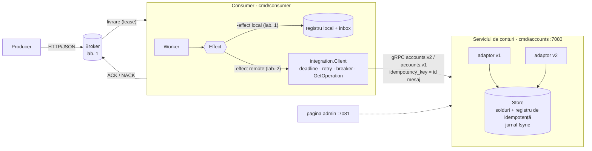
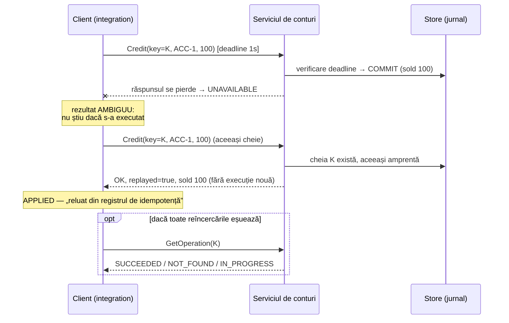

# Laborator 2 — RPC, contracte și integrare

**Student:** Dumitru Micleușanu
**Disciplina:** Programarea Aplicațiilor Distribuite (PAD), 2026

Continuarea [laboratorului 1](../laborator_1). În laboratorul 1, consumer-ul scria efectul (alimentarea unui cont) într-un fișier local. Acum efectul se mută într-un **serviciu separat de conturi, accesat prin gRPC**, cu un contract proiectat explicit.

Cea mai importantă proprietate a integrării: **tratează explicit rezultatul ambiguu**. Când un apel la distanță se termină cu eroare, clientul nu presupune că operația nu a avut loc.

Laboratorul 1 rămâne funcțional, atât în folderul lui (`../laborator_1`), cât și aici: consumer-ul acceptă `-effect local`, iar demo-ul are grupul `-s lab1`.

| Concept | Unde este implementat |
|---|---|
| Contract explicit | `proto/accounts/v1`, `proto/accounts/v2`, [`CONTRACT.md`](CONTRACT.md) — operații, model de erori, reguli de idempotență și evoluție |
| Versionare | două pachete servite simultan; antete `x-api-version`, `deprecation`, `sunset`; `reserved` pentru câmpurile eliminate |
| Compatibilitate | client vechi v1.0 ↔ server actual, client nou ↔ server vechi (negociere v2 → v1), teste pe format binar (wire) |
| Deadline | per încercare + bugetul total al apelantului (derivat din **lease-ul** livrării din lab 1); propagat automat la server; *fail fast* pe server |
| Cancellation | serverul abandonează **înainte de commit** când clientul anulează sau deadline-ul expiră |
| Idempotency | `idempotency_key` = ID-ul mesajului; registru de idempotență durabil în serviciu; amprentă de cerere |
| Fallback | negociere de contract (v1), circuit breaker + **back-pressure** (mesajele așteaptă în broker), citire din cache marcată `Stale` |
| Rezultat ambiguu | clientul `integration` produce explicit `APPLIED / REJECTED / NOT_APPLIED / UNKNOWN`, iar ambiguitatea se rezolvă cu `GetOperation` |

---

## 1. Arhitectură



### Structura (ce este nou față de laboratorul 1)

```
laborator_2/
├── proto/accounts/v1, v2/   contractele gRPC (sursa de adevăr)
├── proto/compat/            contractul v1.0 „înghețat”, pentru testele de compatibilitate
├── gen/                     cod generat (protoc-gen-go, protoc-gen-go-grpc)
├── accounts/                serviciul: Store idempotent, adaptoare v1/v2, deadline, defecte injectate, admin
├── integration/             clientul: rezultate explicite, retry, GetOperation, circuit breaker, fallback
├── consumer/effect.go       efectul ca interfață: LocalEffect (lab. 1) / RemoteEffect (lab. 2)
├── cmd/accounts/            executabilul serviciului + pagina de administrare
├── vendor/                  dependențele gRPC incluse în repo (compilare fără internet)
└── (broker, client, contract, cmd/broker, cmd/producer — din laboratorul 1)
```

---

## 2. Scenariul critic: răspunsul se pierde după efectuarea operației



### Analiza

Clientul care primește o eroare după trimiterea cererii este într-una din trei situații pe care **nu le poate distinge** doar din eroare:

1. cererea nu a ajuns la server;
2. serverul a început, dar a abandonat înainte de commit;
3. serverul a făcut commit, iar răspunsul s-a pierdut sau a întârziat (scenariul critic).

Un client naiv care tratează eroarea ca „nu s-a executat” și retrimite cu o cheie nouă **dublează efectul**. Un client care raportează „eșec” când operația a reușit induce în eroare apelantul (de exemplu, un utilizator plătește a doua oară).

Soluția are trei piese:

* **Cheie de idempotență stabilă.** Reîncercarea cu aceeași cheie este sigură: serviciul recunoaște cheia și întoarce rezultatul original.
* **Interogarea stării (`GetOperation`).** Dacă reîncercările nu primesc răspuns, clientul întreabă direct ce s-a întâmplat cu cheia.
* **Rezultat `UNKNOWN` explicit.** Dacă nici interogarea nu reușește (serviciul complet căzut), rezultatul rămâne `UNKNOWN`. În consumer, un mesaj `UNKNOWN` **nu este confirmat** brokerului: rămâne în coadă și va fi reluat cu aceeași cheie, care lămurește situația.

**Rezultatul măsurat** (`go run ./cmd/demo -s rpc-critic`):

```
  client        sold  asteptat   executii  incercari  verdict
  NAIV           200       100          2          2  ✗ EFECT DUBLAT
  INTEGRARE      100       100          1          2  ✓ corect
```

Aceeași operație, în șapte situații diferite (`-s ambiguitate`):

```
  situatie                   rezultat      sold  cum a fost stabilit
  normal                     APPLIED        100  raspuns direct
  raspuns pierdut o data     APPLIED        100  reincercare cu aceeasi cheie: rezultat reluat din registrul de idempotenta
  raspuns pierdut mereu      APPLIED        100  confirmat prin GetOperation: operatia ESTE aplicata (raspunsul se pierduse)
  raspuns intarziat          APPLIED        100  confirmat prin GetOperation: operatia ESTE aplicata (raspunsul se pierduse)
  refuz inainte de executie  NOT_APPLIED      0  confirmat prin GetOperation: operatia NU exista (serverul nu comite dupa deadline)
  suma peste limita          REJECTED         0  respins de serviciu (rezultat de business)
  serviciu oprit             UNKNOWN          0  nerezolvat: serviciul nu raspunde nici la interogarea de stare
```

| Rezultat | Ce știm despre efect | Ce face consumer-ul cu mesajul |
|---|---|---|
| `APPLIED` | există | ACK |
| `REJECTED` | nu există și nu va exista | NACK fără retry → DLQ |
| `NOT_APPLIED` | sigur nu există | NACK cu retry (amânat în broker) |
| `UNKNOWN` | nu se știe | NACK cu retry — **niciodată** ACK |

---

## 3. Deadline și cancellation

* **Deadline-ul vine din lease.** `RemoteEffect` calculează bugetul apelului ca `lease_until − marjă`: consumer-ul nu lucrează la un mesaj pe care brokerul l-ar putea deja relivra altcuiva. Fiecare încercare RPC are și propriul deadline (`-attempt-timeout`), limitat de bugetul total.
* **Propagare.** gRPC transmite deadline-ul la server (`grpc-timeout`), iar `ctx`-ul serverului expiră odată cu al clientului.
* **Fail fast.** Dacă timpul rămas e mai mic decât durata minimă a operației, serverul refuză imediat, fără să înceapă lucrul (`-min-budget`).
* **Punctul de commit.** Operația lucrează cu `ctx`. Imediat înainte de scrierea durabilă, serverul verifică încă o dată `ctx.Err()`. Anularea sau expirarea **înainte** de commit înseamnă „nimic aplicat”. **După** commit, operația rămâne, iar de aici vine ambiguitatea.
* **Cancellation.** La `Ctrl+C`, consumer-ul anulează contextul. Cererea în curs este anulată pe server înainte de commit, iar mesajul rămâne în broker.

Rezultatul măsurat (`-s deadline`):

```
  deadline 100ms < bugetul minim 300ms  -> DeadlineExceeded: ... operatia NU a fost inceputa
  deadline expirat in timpul lucrului    -> DeadlineExceeded; stare pe server: NOT_FOUND
  clientul anuleaza (ex. Ctrl+C)         -> Canceled;         stare pe server: NOT_FOUND
  commit facut, raspuns dupa deadline    -> DeadlineExceeded; stare pe server: SUCCEEDED  <- de aceea e AMBIGUU
```

## 4. Versionare și compatibilitate

Detaliile sunt în [`CONTRACT.md`](CONTRACT.md) §5. Pe scurt:

* **v1 → v1.1 (compatibil):** s-a adăugat `note = 4`, iar `currency = 5` a fost eliminat și marcat `reserved`. Un client compilat cu v1.0 (`proto/compat/v1_0.proto`) funcționează cu serverul actual: testul `TestOldV1_0ClientStillWorks`.
* **v1 → v2 (incompatibil):** `amount` devine `Money`, iar respingerea de business devine rezultat (`status=FAILED`) în loc de eroare. Prin urmare există un pachet nou, servit **în paralel** cu v1, peste aceeași stare.
* **Negociere:** clientul încearcă v2 și, la `UNIMPLEMENTED` (server vechi), trece automat la v1.
* **Depreciere vizibilă:** răspunsurile v1 poartă `deprecation: true` și `sunset: 2027-06-30`.

## 5. Fallback

| Situație | Fallback |
|---|---|
| serverul nu are v2 | contract v1 (negociere automată) |
| serviciul nu răspunde repetat | **circuit breaker** deschis → cererile nu mai sunt trimise; consumer-ul **oprește preluarea** (back-pressure), iar mesajele așteaptă în broker fără să-și consume tentativele; după `cooldown`, o cerere de probă (half-open) |
| rezultat `NOT_APPLIED` / `UNKNOWN` | mesajul rămâne în broker (NACK cu retry): brokerul din lab 1 este „tamponul” durabil |
| citire de sold cu serviciul căzut | ultima valoare cunoscută, marcată explicit `Stale=true` și `AsOf` |

## 6. Garanții

| # | Garanție | Verificat de |
|---|---|---|
| G1 | Un `Credit` cu aceeași cheie se execută **cel mult o dată**, indiferent de câte ori e trimis, pe ce versiune sau concurent | `TestCreditIsIdempotentByKey`, `TestConcurrentSameKeyExecutesOnce`, `TestV1AndV2ShareState` |
| G2 | Un răspuns pierdut după commit nu produce efect dublu | `TestCriticalLostResponseResolvedByIdempotentRetry`, `TestRemoteLostResponsesExactBalance` |
| G3 | Clientul nu raportează niciodată „eșec” pentru o operație care a avut loc: rezultatul e `APPLIED` sau `UNKNOWN` | `TestAllResponsesLostResolvedByGetOperation`, `TestServiceDownUnknownThenCircuitOpen` |
| G4 | Anularea / deadline-ul înainte de commit nu lasă efect | `TestCancelBeforeCommitHasNoEffect`, `TestClientDeadlinePropagatesAndAbortsBeforeCommit`, `TestCallerCancellation` |
| G5 | Un mesaj este confirmat brokerului doar dacă efectul există (`APPLIED`) | `RemoteEffect` + `TestRemoteServiceDownMessagesWaitInBroker` |
| G6 | Clienții vechi și serverele vechi continuă să funcționeze | testele din `CONTRACT.md` §5 |
| G7 | Operațiile confirmate supraviețuiesc repornirii serviciului (jurnal cu fsync) | `TestStoreRecoversFromJournal`, `scripts/scenariu_rpc.sh` |

## 7. Limite

1. **`UNKNOWN` poate dura.** Dacă serviciul e complet căzut, ambiguitatea se rezolvă abia la revenirea lui, când mesajul e reluat cu aceeași cheie. O pană foarte lungă poate epuiza `max_attempts` din broker, iar mesajul ajunge în DLQ, de unde se face *replay* după revenire. Back-pressure-ul reduce mult acest risc, dar nu îl elimină.
2. **`NOT_FOUND` e sigur doar după deadline + marja de rețea.** Deadline-ul serverului poate expira cu câteva milisecunde după al clientului. Clientul așteaptă `ReconcileGrace` (50 ms) înainte de `GetOperation`. Pe o rețea cu latență mai mare, marja trebuie mărită.
3. **Registrul de idempotență nu expiră.** În producție ar avea o retenție (de ex. 7 zile), după care o cheie veche ar fi tratată ca nouă. Fereastra trebuie să fie mai lungă decât cel mai lung interval posibil de reîncercare.
4. **Amprenta cererii acoperă doar cont + sumă + monedă.** Două cereri care diferă doar prin notă sau referință sunt considerate aceeași operație.
5. **`connection refused` este tratat tot ca ambiguu.** Este prudent, dar pesimist: cererea sigur nu a plecat. Rezultatul final e oricum corect, prin `GetOperation` sau prin reluare.
6. **Un singur nod de serviciu**, fără replicare. Jurnalul protejează la căderea procesului, nu la pierderea discului.
7. **Fără TLS și autentificare** (`insecure.NewCredentials`) — în afara scopului laboratorului.
8. Folderul **`vendor/`** (~18 MB) conține sursele gRPC și protobuf, ca proiectul să se compileze fără acces la internet. Poate fi șters: `go mod tidy` le descarcă din nou.

---

## 8. Rulare

Cerințe: **Go 1.22+**. Toate comenzile se rulează din folderul `laborator_2/`.

### Toate scenariile într-o comandă

```bash
go run ./cmd/demo                    # laboratorul 2: rpc-critic, ambiguitate, versiuni, deadline, lant
go run ./cmd/demo -s rpc-critic      # doar scenariul critic
go run ./cmd/demo -s lab1            # scenariile laboratorului 1 (încă funcționale)
go run ./cmd/demo -s toate           # ambele laboratoare
```

### Procese separate (4 terminale)

```bash
# 1 — brokerul din laboratorul 1 (dashboard http://localhost:7070/)
go run ./cmd/broker -lease 4s

# 2 — serviciul de conturi (pagina admin http://localhost:7081/), pierde 30% din răspunsuri
go run ./cmd/accounts -drop-rate 0.3

# 3 — producer
go run ./cmd/producer -count 12 -accounts 3

# 4 — consumer cu efect prin serviciul gRPC
go run ./cmd/consumer -name c1
go run ./cmd/consumer -name c1 -api v1            # forțează contractul v1
go run ./cmd/consumer -name c1 -effect local      # comportamentul din laboratorul 1
```

Parametri utili pentru `accounts`: `-drop-next N` (următoarele N răspunsuri se pierd după execuție) · `-drop-rate p` · `-slow-ms` (răspuns întârziat după commit) · `-unavailable-next N` (refuz înainte de execuție) · `-processing 50ms` · `-min-budget` · `-disable-v2` (server vechi) · `-data` (jurnal).
Defectele se pot schimba și din pagina de administrare, în timpul rulării.

### Scripturi

```bash
./scripts/scenariu_rpc.sh            # lanț complet; serviciul e oprit și repornit la mijloc
./scripts/scenariu_critic.sh         # scenariul critic din laboratorul 1
```
```powershell
.\scripts\scenariu_rpc.ps1
.\scripts\scenariu_critic.ps1
```

### Teste

```bash
go test ./...                                     # toate (lab. 1 + lab. 2)
go test -race ./...
go test -v -run 'Critical|Lost' ./integration ./consumer
```

### Regenerarea codului din `.proto`

```bash
go install google.golang.org/protobuf/cmd/protoc-gen-go@v1.34.2
go install google.golang.org/grpc/cmd/protoc-gen-go-grpc@v1.5.1
./scripts/gen-proto.sh               # necesită și protoc în PATH
```

---

## 9. Concluzii

* Un apel la distanță are **trei** rezultate posibile, nu două: reușit, eșuat și **necunoscut**. Integrarea corectă îl tratează pe al treilea explicit, în loc să-l rotunjească la „eșec”.
* **Idempotența transformă necunoscutul în sigur:** cu o cheie stabilă, reîncercarea nu mai e un risc, ci un mecanism de aflare a rezultatului.
* **Deadline-ul și cancellation-ul au sens doar împreună cu un punct de commit clar.** Înainte de commit, anularea garantează „nimic aplicat”. După commit, nu mai garantează nimic, iar contractul trebuie să spună asta explicit.
* **Contractul este o interfață publică:** se evoluează doar compatibil, schimbările incompatibile primesc o versiune nouă, iar versiunea veche se retrage anunțat, nu brusc.
* Laboratorul 1 și laboratorul 2 se completează: brokerul oferă *at-least-once* până la consumer, iar serviciul oferă *at-most-once* per cheie. Împreună, cu aceeași cheie pe tot lanțul, efectul se aplică **exact o dată**.
